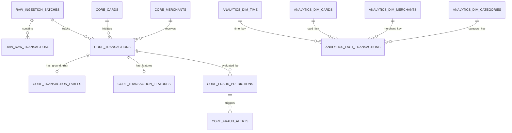

# 04. Thiết kế Cơ sở Dữ liệu PostgreSQL (Database Design)

Hệ thống sử dụng một cơ sở dữ liệu **PostgreSQL** duy nhất được phân tách rõ ràng thành **3 schemas** theo đúng kiến trúc Medallion / Data Warehouse hiện đại, kết hợp với cấu trúc trường dữ liệu đã chuẩn hóa của **Sparkov Credit Card Fraud**:

- **`raw` schema:** Lưu trữ nguyên bản dữ liệu đầu vào (JSONB payload), thông tin lô nạp (`ingestion_batches`) và các bản ghi bị từ chối để phục vụ truy vết (lineage) và chạy lại (reprocessing).
- **`core` schema:** Lưu trữ dữ liệu vận hành đã chuẩn hóa (3NF), tách biệt rõ thực thể Thẻ (`cards`), Cửa hàng (`merchants`), Giao dịch (`transactions`), Nhãn thực tế (`transaction_labels`), Đặc trưng (`transaction_features`), Dự đoán (`fraud_predictions`) và Cảnh báo điều tra (`fraud_alerts`).
- **`analytics` schema:** Mô hình hóa theo cấu trúc **Star Schema** (`fact_transactions`, các bảng `dim_*`) và các bảng/view tổng hợp (`agg_*`) giúp tối ưu tốc độ truy vấn cho 6 trang Dashboard.

---

## 4.1. Sơ đồ Quan hệ Thực thể Tổng quan (ER Overview)

---

## 4.2. Thiết kế Chi tiết Tầng `raw` (Raw Schema)

Mục tiêu của tầng `raw` là ghi nhận dữ liệu nguồn với sự can thiệp tối thiểu để đảm bảo khả năng **tái xử lý (reprocessing)** khi logic làm sạch hoặc tạo đặc trưng thay đổi.

### 1. Bảng `raw.ingestion_batches`

Theo dõi từng đợt chạy pipeline nạp dữ liệu (cả Batch CSV và micro-batch từ Streaming).

| Tên cột | Kiểu dữ liệu PostgreSQL | Ràng buộc / Ghi chú |
| :--- | :--- | :--- |
| `batch_id` | `UUID` | `PRIMARY KEY` — Mã định danh duy nhất của đợt nạp |
| `source_name` | `VARCHAR(128)` | `NOT NULL` — Tên nguồn (VD: `sparkov_fraudTrain_csv`, `sparkov_fraudTest_csv`, `kafka_stream`) |
| `started_at` | `TIMESTAMPTZ` | `NOT NULL DEFAULT NOW()` — Thời điểm bắt đầu nạp |
| `completed_at` | `TIMESTAMPTZ` | `NULL` — Thời điểm hoàn tất |
| `status` | `VARCHAR(32)` | `NOT NULL` — Trạng thái: `RUNNING`, `SUCCEEDED`, `FAILED`, `PARTIAL` |
| `input_count` | `BIGINT` | `DEFAULT 0` — Tổng số bản ghi đọc từ nguồn |
| `accepted_count` | `BIGINT` | `DEFAULT 0` — Số bản ghi vượt qua kiểm định (Valid) |
| `rejected_count` | `BIGINT` | `DEFAULT 0` — Số bản ghi bị từ chối do lỗi chất lượng dữ liệu |
| `error_summary` | `JSONB` | Chi tiết thống kê lỗi (VD: thiếu cột, `amt <= 0`, trùng `trans_num`...) |

### 2. Bảng `raw.raw_transactions`

Lưu trữ từng bản ghi gốc dưới dạng `JSONB` cùng trạng thái kiểm định.

| Tên cột | Kiểu dữ liệu PostgreSQL | Ràng buộc / Ghi chú |
| :--- | :--- | :--- |
| `raw_id` | `BIGSERIAL` | `PRIMARY KEY` |
| `source_trans_num` | `VARCHAR(64)` | Mã giao dịch gốc `trans_num` từ Sparkov (có thể `NULL` nếu bản ghi lỗi thiếu khóa) |
| `source_name` | `VARCHAR(128)` | `NOT NULL` — Nguồn dữ liệu |
| `payload` | `JSONB` | `NOT NULL` — Toàn bộ bản ghi gốc dưới dạng JSON (bao gồm cả `first`, `last`, `street`...) |
| `is_valid` | `BOOLEAN` | `NOT NULL DEFAULT TRUE` — Kết quả kiểm định Pandera |
| `validation_errors` | `JSONB` | `NULL` — Danh sách lỗi cụ thể nếu `is_valid = FALSE` |
| `batch_id` | `UUID` | `REFERENCES raw.ingestion_batches(batch_id)` |
| `ingested_at` | `TIMESTAMPTZ` | `NOT NULL DEFAULT NOW()` — Thời điểm hệ thống tiếp nhận bản ghi |

---

## 4.3. Thiết kế Chi tiết Tầng `core` (Core Schema)

Tầng `core` chuẩn hóa dữ liệu giao dịch Sparkov về dạng quan hệ chặt chẽ, sử dụng tên cột đã chuẩn hóa (`state_code`, `lon`, `merch_lon`) và tách riêng nhãn thực tế.

### 1. Bảng `core.cards` (Tương ứng thực thể tài khoản/chủ thẻ)

Lưu thông tin hồ sơ thẻ tín dụng và nhân khẩu học tĩnh của chủ thẻ.

| Tên cột | Kiểu dữ liệu PostgreSQL | Ràng buộc / Ghi chú |
| :--- | :--- | :--- |
| `card_id` | `BIGSERIAL` | `PRIMARY KEY` — Khóa tự tăng nội bộ |
| `cc_num` | `VARCHAR(32)` | `UNIQUE NOT NULL` — Mã số thẻ tín dụng gốc trong Sparkov |
| `gender` | `VARCHAR(8)` | Giới tính chủ thẻ (`M` / `F`) |
| `dob` | `DATE` | Ngày sinh chủ thẻ (`YYYY-MM-DD`) |
| `job` | `VARCHAR(128)` | Nghề nghiệp chủ thẻ |
| `city` | `VARCHAR(128)` | Thành phố cư trú |
| `state_code` | `VARCHAR(16)` | Mã bang 2 ký tự (đổi tên từ cột gốc `state`) |
| `zip` | `VARCHAR(16)` | Mã bưu chính |
| `lat` | `NUMERIC(9,6)` | Vĩ độ nơi cư trú của chủ thẻ |
| `lon` | `NUMERIC(9,6)` | Kinh độ nơi cư trú của chủ thẻ (đổi tên từ cột gốc `long`) |
| `city_pop` | `INTEGER` | Dân số thành phố cư trú |
| `created_at` | `TIMESTAMPTZ` | `NOT NULL DEFAULT NOW()` — Thời điểm ghi nhận thẻ lần đầu |

### 2. Bảng `core.merchants` (Đơn vị chấp nhận thẻ / Cửa hàng)

| Tên cột | Kiểu dữ liệu PostgreSQL | Ràng buộc / Ghi chú |
| :--- | :--- | :--- |
| `merchant_id` | `BIGSERIAL` | `PRIMARY KEY` |
| `merchant_name` | `VARCHAR(255)` | `UNIQUE NOT NULL` — Tên cửa hàng gốc (`merchant` trong Sparkov) |
| `primary_category` | `VARCHAR(64)` | Danh mục chi tiêu chính của cửa hàng (`category`) |
| `created_at` | `TIMESTAMPTZ` | `NOT NULL DEFAULT NOW()` |

### 3. Bảng `core.transactions` (Giao dịch chuẩn hóa)

| Tên cột | Kiểu dữ liệu PostgreSQL | Ràng buộc / Ghi chú |
| :--- | :--- | :--- |
| `transaction_id` | `BIGSERIAL` | `PRIMARY KEY` — Khóa chính nội bộ |
| `trans_num` | `VARCHAR(64)` | `UNIQUE NOT NULL` — Mã định danh giao dịch gốc (32 ký tự hex), đảm bảo tính **Idempotent** |
| `card_id` | `BIGINT` | `NOT NULL REFERENCES core.cards(card_id)` |
| `merchant_id` | `BIGINT` | `NOT NULL REFERENCES core.merchants(merchant_id)` |
| `category` | `VARCHAR(64)` | `NOT NULL` — Danh mục giao dịch (`shopping_net`, `grocery_pos`, `gas_transport`...) |
| `amt` | `NUMERIC(18,2)` | `NOT NULL CHECK (amt > 0)` — Số tiền giao dịch (USD), tuyệt đối dùng `NUMERIC` thay vì `FLOAT` |
| `event_time` | `TIMESTAMPTZ` | `NOT NULL` — Thời điểm giao dịch xảy ra (`trans_date_trans_time`) |
| `unix_time` | `BIGINT` | `NOT NULL` — Unix timestamp (giây) phục vụ tính toán cửa sổ trượt tốc độ cao |
| `merch_lat` | `NUMERIC(9,6)` | Vĩ độ điểm quẹt thẻ tại thời điểm giao dịch |
| `merch_lon` | `NUMERIC(9,6)` | Kinh độ điểm quẹt thẻ (đổi tên từ `merch_long`) |
| `ingested_at` | `TIMESTAMPTZ` | `NOT NULL DEFAULT NOW()` — Thời điểm nền tảng nhận được giao dịch |
| `processing_status` | `VARCHAR(32)` | `NOT NULL DEFAULT 'PROCESSED'` — Trạng thái xử lý (`RAW`, `PROCESSED`, `SCORED`) |
| `batch_id` | `UUID` | `REFERENCES raw.ingestion_batches(batch_id)` — Truy vết nguồn gốc lô nạp |

> **Phân biệt rõ ràng các mốc thời gian (Temporal Correctness):**
> - `event_time`: Thời điểm giao dịch thực sự diễn ra (`trans_date_trans_time`).
> - `ingested_at`: Thời điểm hệ thống tiếp nhận giao dịch vào DB.

### 4. Bảng `core.transaction_labels` (Nhãn thực tế tách biệt)

Giữ nhãn thực tế (`is_fraud`) tách biệt hoàn toàn khỏi bảng giao dịch và bảng đặc trưng để chống rò rỉ dữ liệu.

| Tên cột | Kiểu dữ liệu PostgreSQL | Ràng buộc / Ghi chú |
| :--- | :--- | :--- |
| `transaction_id` | `BIGINT` | `PRIMARY KEY REFERENCES core.transactions(transaction_id)` |
| `actual_is_fraud` | `BOOLEAN` | `NOT NULL` — Nhãn thực tế (`TRUE` = Gian lận, `FALSE` = Hợp lệ) |
| `label_source` | `VARCHAR(64)` | `NOT NULL` — Nguồn nhãn (`SPARKOV_GROUND_TRUTH`, `ANALYST_CONFIRMED`) |
| `labeled_at` | `TIMESTAMPTZ` | `NOT NULL DEFAULT NOW()` — Thời điểm nhãn có hiệu lực |

### 5. Bảng `core.transaction_features` (Đặc trưng đã trích xuất)

Lưu trữ bộ đặc trưng tính toán tại thời điểm giao dịch phục vụ cả chấm điểm trực tuyến, giải thích cảnh báo và kiểm toán mô hình.

| Tên cột | Kiểu dữ liệu PostgreSQL | Ý nghĩa ngắn gọn |
| :--- | :--- | :--- |
| `transaction_id` | `BIGINT` | `PRIMARY KEY REFERENCES core.transactions(transaction_id)` |
| `tx_count_1h` | `INTEGER` | Số giao dịch của thẻ `cc_num` trong 1 giờ trước |
| `tx_count_6h` | `INTEGER` | Số giao dịch của thẻ `cc_num` trong 6 giờ trước |
| `tx_count_24h` | `INTEGER` | Số giao dịch của thẻ `cc_num` trong 24 giờ trước |
| `amt_sum_1h` | `NUMERIC(18,2)` | Tổng chi tiêu của thẻ trong 1 giờ trước |
| `amt_sum_24h` | `NUMERIC(18,2)` | Tổng chi tiêu của thẻ trong 24 giờ trước |
| `amt_to_card_mean_ratio` | `NUMERIC(12,4)` | Tỷ lệ số tiền hiện tại so với trung bình lịch sử của thẻ |
| `amt_to_cat_median_ratio` | `NUMERIC(12,4)` | Tỷ lệ số tiền hiện tại so với trung vị danh mục `category` |
| `unique_merchants_24h` | `INTEGER` | Số cửa hàng khác nhau thẻ đã quẹt trong 24 giờ qua |
| `time_since_last_tx_sec` | `BIGINT` | Số giây kể từ lần quẹt thẻ liền trước |
| `dist_home_to_merch_km` | `NUMERIC(10,3)` | Khoảng cách từ nhà chủ thẻ tới cửa hàng (km) |
| `merch_to_merch_dist_km` | `NUMERIC(10,3)` | Khoảng cách từ cửa hàng lần quẹt trước tới cửa hàng hiện tại (km) |
| `implied_speed_kmh` | `NUMERIC(10,2)` | Vận tốc di chuyển ngầm định giữa 2 lần quẹt thẻ (km/h) |
| `hour_of_day` | `SMALLINT` | Giờ giao dịch (`0–23`) |
| `day_of_week` | `SMALLINT` | Thứ trong tuần (`0–6`) |
| `is_weekend` | `BOOLEAN` | Giao dịch vào cuối tuần |
| `is_night_tx` | `BOOLEAN` | Giao dịch ban đêm (`22h–04h` sáng) |
| `customer_age` | `NUMERIC(5,2)` | Tuổi chủ thẻ tại thời điểm giao dịch |
| `feature_generated_at` | `TIMESTAMPTZ` | `NOT NULL DEFAULT NOW()` — Thời điểm sinh đặc trưng |

### 6. Bảng `core.fraud_predictions` (Kết quả chấm điểm rủi ro)

Một giao dịch có thể được chấm điểm bởi nhiều phương pháp (`RULE_BASED`, `ML_MODEL`, hoặc `HYBRID_ENSEMBLE`) hoặc nhiều phiên bản mô hình khác nhau.

| Tên cột | Kiểu dữ liệu PostgreSQL | Ràng buộc / Ghi chú |
| :--- | :--- | :--- |
| `prediction_id` | `BIGSERIAL` | `PRIMARY KEY` |
| `transaction_id` | `BIGINT` | `NOT NULL REFERENCES core.transactions(transaction_id)` |
| `detection_method` | `VARCHAR(32)` | `NOT NULL` — `RULE_BASED`, `ML_MODEL`, hoặc `HYBRID` |
| `risk_score` | `NUMERIC(6,5)` | `NOT NULL CHECK (risk_score BETWEEN 0 AND 1)` — Điểm rủi ro chuẩn hóa `[0.00000, 1.00000]` |
| `is_flagged` | `BOOLEAN` | `NOT NULL` — Có vượt ngưỡng nghi ngờ gian lận hay không |
| `risk_level` | `VARCHAR(16)` | `NOT NULL` — `LOW` (`0.00–0.29`), `MEDIUM` (`0.30–0.69`), `HIGH` (`0.70–1.00`) |
| `model_version` | `VARCHAR(64)` | Phiên bản tập luật hoặc mô hình (VD: `rules_v1.0`, `lgbm_v1.2`) |
| `predicted_at` | `TIMESTAMPTZ` | `NOT NULL DEFAULT NOW()` |

### 7. Bảng `core.fraud_alerts` (Cảnh báo và Quản lý Điều tra)

Khi một dự đoán có mức rủi ro `MEDIUM` hoặc `HIGH` (hoặc `is_flagged = TRUE`), một cảnh báo sẽ được sinh ra để Fraud Analyst xử lý.

| Tên cột | Kiểu dữ liệu PostgreSQL | Ràng buộc / Ghi chú |
| :--- | :--- | :--- |
| `alert_id` | `BIGSERIAL` | `PRIMARY KEY` |
| `prediction_id` | `BIGINT` | `NOT NULL REFERENCES core.fraud_predictions(prediction_id)` |
| `transaction_id` | `BIGINT` | `NOT NULL REFERENCES core.transactions(transaction_id)` |
| `alert_status` | `VARCHAR(32)` | `NOT NULL DEFAULT 'NEW'` — `NEW`, `INVESTIGATING`, `CONFIRMED_FRAUD`, `FALSE_POSITIVE` |
| `alert_reason` | `JSONB` | `NOT NULL` — Danh sách mã luật bị vi phạm (VD: `["R001", "R005"]`) và giải thích chi tiết |
| `reviewer_notes` | `TEXT` | Ghi chú của chuyên viên phân tích khi điều tra |
| `created_at` | `TIMESTAMPTZ` | `NOT NULL DEFAULT NOW()` — Thời điểm tạo cảnh báo |
| `reviewed_at` | `TIMESTAMPTZ` | `NULL` — Thời điểm cập nhật kết quả điều tra |

---

## 4.4. Thiết kế Chi tiết Tầng `analytics` (Star Schema & Aggregates)

Tầng `analytics` phục vụ trực tiếp cho các truy vấn tổng hợp tốc độ cao của FastAPI và React Dashboard.

### 1. Bảng Sự kiện Trung tâm: `analytics.fact_transactions`

Mỗi dòng đại diện cho một giao dịch đã xử lý hoàn chỉnh:

- **Khóa (Keys):**
  - `transaction_id` (`BIGINT PRIMARY KEY`)
  - `trans_num` (`VARCHAR(64) UNIQUE`)
  - `time_key` (`INTEGER REFERENCES analytics.dim_time(time_key)`) — định dạng `YYYYMMDDHH`
  - `card_key` (`BIGINT REFERENCES analytics.dim_cards(card_key)`)
  - `merchant_key` (`BIGINT REFERENCES analytics.dim_merchants(merchant_key)`)
  - `category_key` (`SMALLINT REFERENCES analytics.dim_categories(category_key)`)
- **Độ đo & Cờ (Measures & Flags):**
  - `amt` (`NUMERIC(18,2)`)
  - `dist_home_to_merch_km` (`NUMERIC(10,3)`)
  - `implied_speed_kmh` (`NUMERIC(10,2)`)
  - `tx_count_24h` (`INTEGER`)
  - `risk_score` (`NUMERIC(6,5)`)
  - `risk_level` (`VARCHAR(16)`)
  - `is_flagged` (`BOOLEAN`) — Giao dịch bị hệ thống gắn cờ nghi ngờ
  - `is_confirmed_fraud` (`BOOLEAN NULL`) — Nhãn gian lận đã xác thực (từ `transaction_labels` hoặc sau khi Analyst xác nhận `CONFIRMED_FRAUD`)

### 2. Các Bảng Chiều (Dimension Tables)

| Tên bảng chiều | Các thuộc tính chính | Mục đích phân tích |
| :--- | :--- | :--- |
| `analytics.dim_time` | `time_key`, `date_actual`, `year`, `month`, `day`, `hour_of_day`, `day_of_week`, `day_name`, `is_weekend`, `is_night_window` | Phân tích xu hướng theo giờ, ngày, thứ trong tuần, tháng và heatmap `Hour × Weekday` |
| `analytics.dim_cards` | `card_key`, `cc_num`, `gender`, `age_group` (`<25`, `25-35`, `35-50`, `50-65`, `65+`), `city`, `state_code`, `city_pop`, `job` | Phân tích gian lận theo độ tuổi, bang (`state_code`), quy mô đô thị và hành vi chủ thẻ |
| `analytics.dim_merchants` | `merchant_key`, `merchant_name`, `primary_category` | Xếp hạng cửa hàng có tỷ lệ nghi ngờ/gian lận cao nhất |
| `analytics.dim_categories` | `category_key`, `category_code` (`shopping_net`, `grocery_pos`...), `is_online_channel` (`_net` vs `_pos`) | So sánh rủi ro giữa kênh Online (`_net`) và quẹt thẻ tại quầy POS (`_pos`) |

### 3. Các Bảng / Materialized Views Tổng hợp (Aggregates)

| Tên View / Bảng tổng hợp | Nội dung tổng hợp | Phục vụ trang Dashboard |
| :--- | :--- | :--- |
| `analytics.agg_hourly_transactions` | Tổng số giao dịch, tổng tiền (`SUM(amt)`), số giao dịch nghi ngờ, số gian lận xác nhận theo từng giờ | *Executive Overview*, *Live Monitoring*, *Transaction Analytics* |
| `analytics.agg_daily_fraud` | Thống kê theo ngày: lưu lượng, số lượng `is_flagged`, số lượng `is_confirmed_fraud`, tổng tiền rủi ro, `flagged_rate`, `confirmed_fraud_rate` | *Executive Overview*, *Fraud Analytics* |
| `analytics.agg_category_metrics` | Tổng hợp theo 14 `category`: số lượng, trung bình/trung vị `amt`, tỷ lệ nghi ngờ và tỷ lệ gian lận thực tế | *Transaction Analytics*, *Fraud Analytics* |

> **Chiến lược tối ưu:** Bắt đầu bằng các **SQL Views** tiêu chuẩn để đảm bảo dữ liệu luôn mới nhất; khi khối lượng vượt trên 1 triệu bản ghi làm chậm thời gian phản hồi API (> 200ms), chuyển các view tổng hợp lịch sử sang **Materialized Views** (`REFRESH MATERIALIZED VIEW CONCURRENTLY`).

---

## 4.5. Các Quy tắc Kỹ thuật Cơ sở Dữ liệu (Database Engineering Rules)

1. **Kiểu dữ liệu tiền tệ chính xác:** Luôn dùng `NUMERIC(18,2)` cho cột `amt` và các cột tổng tiền (`amt_sum_1h`, `amt_sum_24h`), không dùng kiểu `REAL`/`FLOAT` trong PostgreSQL để tránh sai số dấu phẩy động.
2. **Đảm bảo tính Idempotent khi nạp dữ liệu:** Đặt ràng buộc `UNIQUE` trên `core.transactions(trans_num)`. Sử dụng cú pháp `INSERT ... ON CONFLICT (trans_num) DO NOTHING` (hoặc `DO UPDATE`) để việc chạy lại một batch hoặc nhận trùng message từ Kafka không bao giờ tạo ra bản ghi giao dịch nhân đôi.
3. **Chiến lược Đánh chỉ mục (Indexing Strategy):**
   - `idx_core_tx_card_unixtime ON core.transactions (card_id, unix_time DESC)`: Phục vụ truy vấn cửa sổ trượt `1h/6h/24h` theo thẻ cực nhanh.
   - `idx_core_tx_event_time ON core.transactions (event_time)`: Phục vụ lọc theo khoảng thời gian trên Dashboard.
   - `idx_core_tx_category ON core.transactions (category)`: Phục vụ lọc theo danh mục chi tiêu.
   - `idx_core_alerts_status_created ON core.fraud_alerts (alert_status, created_at DESC)`: Phục vụ trang *Live Monitoring* và *Investigation*.
4. **Quản lý Schema bằng Migrations:** Mọi thay đổi cấu trúc bảng trong `database/schema.sql` và `database/migrations/` đều được quản lý phiên bản rõ ràng.
